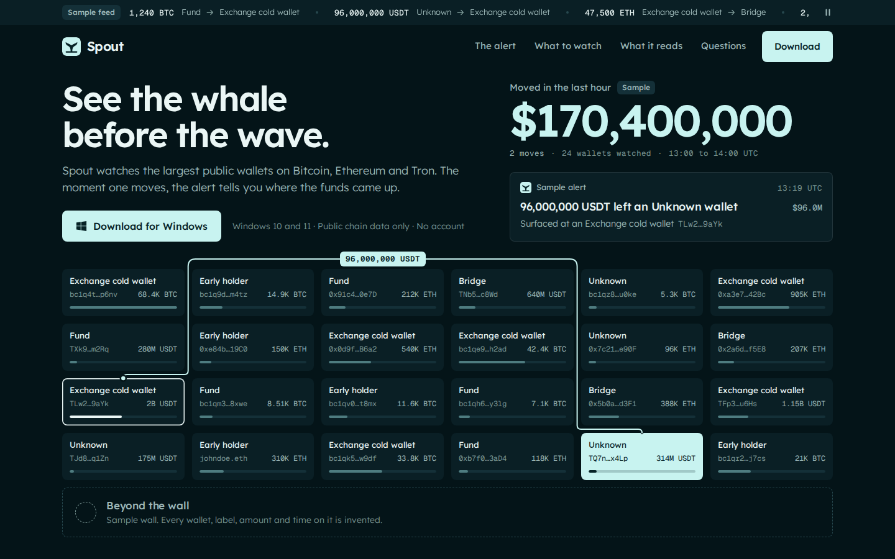
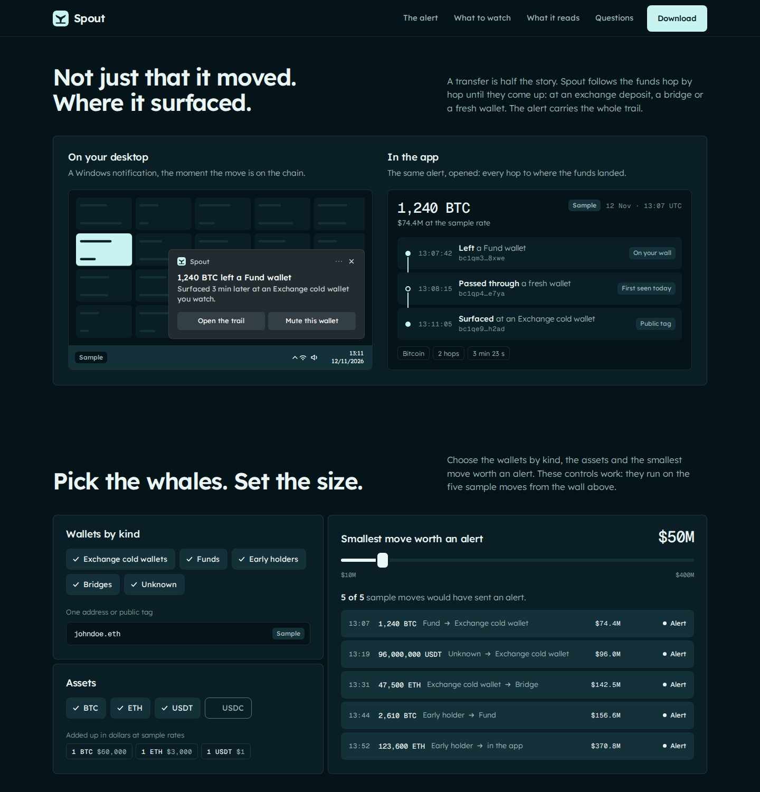
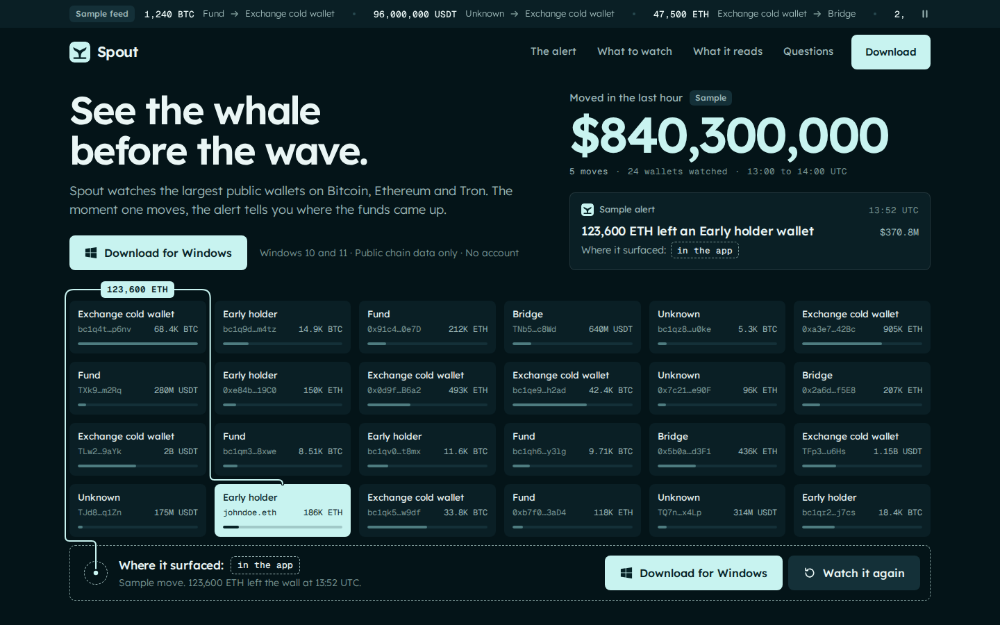

<h1 align="center">Spout: OSINT whale alerts for large crypto wallets</h1>

<b>See the whale before the wave.</b> Watches the largest public wallets and tells you where the funds came up next.

OSINT · crypto · whale alert · large wallet monitoring · blockchain monitoring · on-chain · windows

> **Status: v1.3.3.** The app is out — [download Spout for Windows](https://awesomeosint.tools/spout/).

## Why this exists

The big wallets move before the headlines. By the time the story breaks, the move is two hops old.

## Why it is different

Price alerts tell you what everyone already knows. Spout watches the wallets themselves and tells you when one moves — and where the funds come up next.

## The idea

- **One object.** A whale's spout: the plume that shows above the surface when something big comes up.
- **One number.** The amount moved in the last hour.
- **Colour.** Deep water `#041418` and white. Foam `#C8F3F0` marks the wallet that is moving, its spout, the big number and the download.
- **The main feature.** Where it surfaced: for a big move Spout does not stop at "it moved". It follows the funds to where they come up next (an exchange deposit, a bridge, a fresh wallet) and puts the trail in the alert.

## The demo on the page

The first screen is a wall of 24 watched wallets, each with a label by kind, a shortened address and a balance bar. A sample hour plays on it: a tile lights, a spout rises from it, travels above the wall with the amount riding on it and lands on the tile where the funds came up; the balances change, the alert card says it in words and the amount is added to "Moved in the last hour". The spout runs in the gutters between tiles and never over one. Four moves land on the wall. The fifth and biggest leaves it: its spout goes over the top, down the outside of the wall and into a dashed tile under it that reads "Where it surfaced: in the app", next to the download and a "Watch it again" button. The run waits while the wall is off screen or the tab is hidden; with reduced motion it shows the final state at once.

Further down, the watch controls are real: the kind chips, the asset chips and the size slider are applied to the same five sample moves, and the list shows which of them would have sent an alert and why the others would not.

